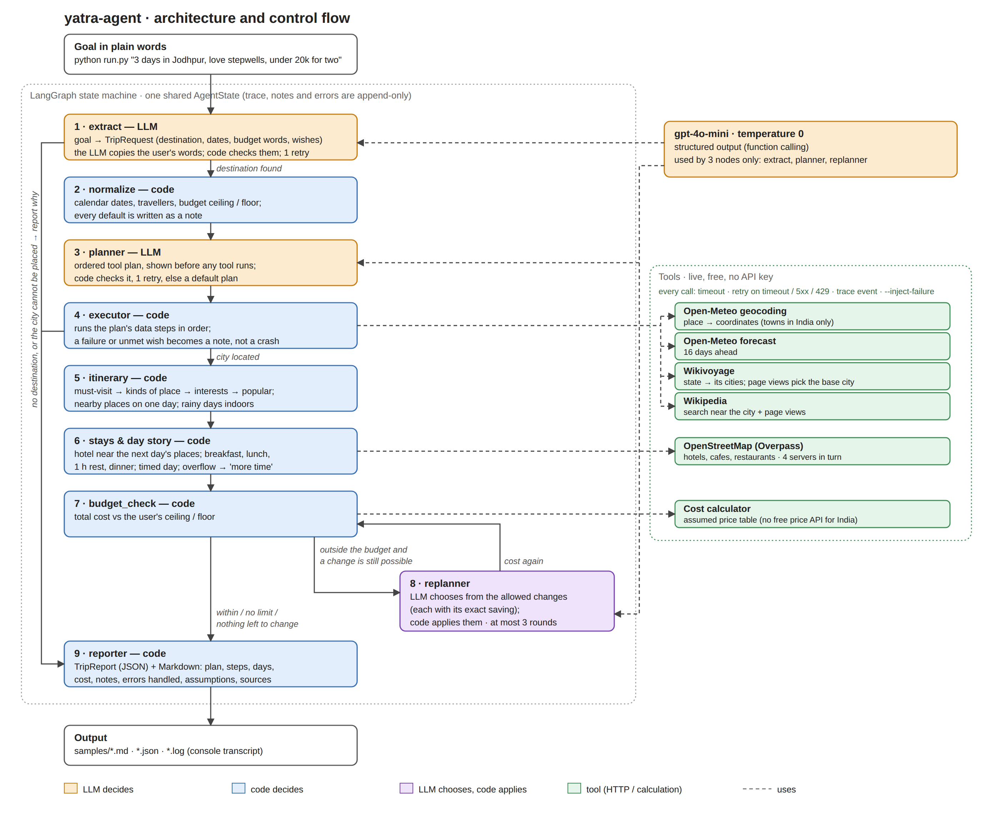

# yatra-agent

A trip planner for India that works like an agent. You write your trip in plain words, and it:

1. understands the goal,
2. **writes a plan before doing anything**,
3. looks things up on live, free websites (weather, Wikipedia, maps),
4. recovers when one of them fails,
5. keeps the trip inside your budget,
6. gives you a day-by-day plan as a report (Markdown + JSON).

**[1-page write-up](docs/writeup.pdf)** · **[Architecture diagram](docs/architecture.png)** · **[Sample runs](samples/)**

```
python run.py "3 days in Jodhpur next weekend, must see Mehrangarh Fort, love stepwells and street food, under 20k for two"
```

```
Day 1 · Sat 24 Oct · Clear sky, 24–37°C, rain 0%
08:40  Drop the bags at MH Guest House (check-in is later)          15 min
09:00  Breakfast at Café Mehran (cafe, 0.1 km)                      45 min
09:50  Mehrangarh (must visit)                                  2 h 30 min
12:30  Toorji Ka Jhalra (for: stepwells)                            45 min
13:20  Lunch at Open House (restaurant, <0.1 km)                       1 h
...
```

---

## What you need

- **Python 3.10 or newer**. Check with `python --version`.
- **An OpenAI API key**. This is the only key needed. Every other service it uses is free and needs no key.
- An internet connection.

---

## Setup (one time)

**1. Get the code**

```bash
git clone https://github.com/sahilvermahr16-cmyk/yatra-agent.git
cd yatra-agent
```

(Or click **Code → Download ZIP** on GitHub, unzip it, and open a terminal in that folder.)

**2. Install**

Windows (PowerShell):

```powershell
python -m venv .venv
.venv\Scripts\Activate.ps1
pip install -r requirements.txt
```

macOS / Linux:

```bash
python3 -m venv .venv
source .venv/bin/activate
pip install -r requirements.txt
```

**3. Paste your API key**

Make a copy of `.env.example` named `.env`:

```bash
copy .env.example .env     # Windows
cp .env.example .env       # macOS / Linux
```

Open `.env` and put your key after the `=` sign:

```
OPENAI_API_KEY=sk-your-key-here
```

That's it. `.env` is never uploaded to GitHub.

---

## Run it

```bash
python run.py "your trip in plain words"
```

A run takes about 20–60 seconds. It prints each stage on screen: the goal as understood, the plan, every tool call, the budget check, and the trip day by day.

**To save the report**, add `--out`:

```bash
python run.py "2 days in Jaipur, love forts, under 10000" --out samples/my_trip
```

This saves three files:
- `samples/my_trip.md`: the report;
- `samples/my_trip.json`: the same report as JSON;
- `samples/my_trip.log`: what was printed on screen.

**Goals to try**

| Goal | What it shows |
|---|---|
| `"3 days in Jodhpur next weekend, must see Mehrangarh Fort, love stepwells and street food, under 20k for two"` | a normal trip |
| `"2 days in Jaipur this weekend, must visit Amber Fort, love forts and bazaars, around 12000" --inject-failure weather_timeout` | the weather service is made to fail; the agent continues without it and says so |
| `"4 days in Udaipur for 2 people, must see City Palace, love lakes, max 15000 total"` | over budget; the agent changes the plan to fit |
| `"jaipur 2 din ghumna h 10k me"` | Hinglish works too |
| `"3 days in Rajasthan, I like palaces"` | a state; the agent picks the city |
| `"I want a relaxing vacation, you choose"` | an unclear goal; the agent stops before planning and says it needs a city or state |

`--inject-failure` can be `weather_timeout`, `places_timeout`, `geocode_timeout` or `osm_timeout`.

The three sample runs made with the first three goals are in [`samples/`](samples/).

---

## If something goes wrong

| Problem | Fix |
|---|---|
| PowerShell says running scripts is disabled | Run `Set-ExecutionPolicy -Scope Process -ExecutionPolicy Bypass`, then activate again |
| `OPENAI_API_KEY` error | Check that the file is named exactly `.env` (not `.env.txt`) and the key is pasted after `=` |
| No hotels or restaurants in the plan | The free map servers (OpenStreetMap) were busy. The days are still planned; run again in a few minutes |
| No weather in the plan | Forecasts reach only 16 days ahead; a later trip is planned without weather |

---

## Optional: use another LLM instead of OpenAI

Any provider with an OpenAI-compatible API (for example Groq, Google Gemini, OpenRouter or a local Ollama) can be used:

1. In `.env`, put that provider's key as `OPENAI_API_KEY` and add its address as `OPENAI_BASE_URL=...`.
2. In `config.py`, change `LLM_MODEL = "gpt-4o-mini"` to that provider's model name.

The model must support function calling (tool calling). The agent was tested only with `gpt-4o-mini`.

---

## Check it without an API key

```bash
python -m pytest -q
```

This runs 241 tests. They need no key and spend nothing.

---

## How it works



| Stage | Done by | What happens |
|---|---|---|
| 1. Read the goal | LLM | Picks out the city, dates, travellers, budget, must-see places and interests; code checks them, 1 retry |
| 2. Complete the request | code | Turns them into exact dates and rupees; fills defaults and says so |
| 3. Plan | LLM, checked by code | Writes the list of steps before acting; a wrong plan is retried once, else a default plan is used |
| 4. Execute | code, calling tools | Runs each step; a failed step becomes a note, not a crash |
| 5a. Build the days | code | Most important places first, nearby places together, indoor places on rainy days |
| 5b. Stays and food | code + OpenStreetMap | A hotel near the next day's places, meals, a rest, and the timing of every day |
| 6. Budget check | code | Prices the trip and compares it with the budget |
| 7. Replan | LLM chooses, code applies | Outside the budget: the LLM picks from the allowed changes; code applies them, re-picks the hotel, meals and timeline, and checks the budget again (up to 3 rounds) |
| 8. Report | code | A Markdown report (plan, steps, days, cost, notes, assumptions, sources) and JSON that also records every tool call |

The tools (all free, no key): Open-Meteo (place search and weather), Wikivoyage (travel guide), Wikipedia (sights), OpenStreetMap (hotels and food), and a cost calculator in code.

More detail is in [`docs/how-it-works.md`](docs/how-it-works.md): the tools, self-correction, every failure and how it is handled, assumptions and limitations.

---

## Where to find each deliverable

| Deliverable | Where |
|---|---|
| Architecture diagram | [`docs/architecture.png`](docs/architecture.png) |
| Sample runs (plan, tool calls, final output) | [`samples/`](samples/) |
| 1-page write-up | [`docs/writeup.pdf`](docs/writeup.pdf) |
| Assumptions and simulated tools | [`docs/how-it-works.md`](docs/how-it-works.md#7-assumptions-mock-data-and-simulated-tools), and at the end of every report |
| Evaluation of the agent | [`eval/results_log.md`](eval/results_log.md) |

---

## Note

I used an AI assistant to help while building this project.
